[README.md](https://github.com/user-attachments/files/34735538/README.md)

<div align="center">



<h2 align="center">Senior Cybersecurity Specialist. SOC Lead.<br>Free training for the next generation.</h2>

<p align="center">I'm Ahsan Khan — I spend my days leading threat hunting, incident response, and SOC operations, and my evenings building free, structured courses so newcomers don't have to learn the hard way I did.</p>


<br><br>

<a href="#foundation"></a>
<a href="https://www.linkedin.com/in/ahsan-khan-helping-you-to-start-a-career-in-cyber-security-677a1a5b"></a>

<br><br>

**[About](#about)** · **[Awards](#awards)** · **[Foundation](#foundation)** · **[Intermediate](#intermediate)** · **[Challenges](#challenges)** · **[Connect](#connect)**

</div>

```bash
$ whoami
Ahsan Khan | Senior Cybersecurity Specialist & SOC Lead

$ cat experience.txt
13+ years in enterprise cyber defense
```

> [!NOTE]
> Want the interactive quizzes? Open the live course site: **[ADD LIVE WEBSITE LINK]**. Here on GitHub, each knowledge check opens as an expandable question with its answer.

---

## About

`// ABOUT`

**13+ years defending enterprise networks — now teaching the path in.**

I've spent over thirteen years on the front line of enterprise cyber defense — leading SOC operations, running incident response, and hunting threats across some of the environments most exposed to modern attackers. My work centers on **malware analysis, digital forensics, and email security**, backed by hands-on leadership in compliance and detection engineering.

Along the way I've helped transform SOC environments to align with **ISO/IEC 27001:2022, NIST, and MITRE ATT&CK**, building the runbooks and use cases that turn a reactive team into a proactive one. Today, as a Senior Cybersecurity Specialist, my focus has shifted toward **SIEM, XDR, IAM, and cloud security** — the tools shaping how the next wave of threats gets caught.

None of that matters, though, if the field stays closed off to newcomers. That's why I built the free courses below — a real, structured path into cybersecurity, written the way I wish someone had explained it to me thirteen years ago.

### Certifications & Training

| Certifications | Training completed |
| :-- | :-- |
| Cisco CBROPS | CISM (Trained) |
| ISC² CC | CFR-410 (Trained) |
| EC-Council CSA | |
| Microsoft SC-100 · SC-200 · SC-300 · AZ-104 · MS-102 | |
| PCDRA | |
| ISO/IEC 42001:2023 Lead Auditor | |
| ISO/IEC 27001:2022 Associate | |

### Core Skills

| Area | Skills |
| :-- | :-- |
| SIEM & XDR | Sentinel · QRadar · Splunk · Cortex XDR |
| Threat Intelligence | STIX/TAXII · MITRE ATT&CK · IOC Detection |
| Investigation | Digital Forensics |
| Governance & Identity | GRC · IAM |

---

## Awards

`// RECOGNITION`

**Awards & recognition earned along the way.**

| | Award | Details |
| :-: | :-- | :-- |
| 🏆 | **Global Recognition Award — 2026** | Winner, awarded for contributions to enterprise cyber defense. |
| 🌟 | **Rising Star of the Year — Finalist** | Finalist recognition in cybersecurity. |
| 🎖️ | **Multiple Excellence Awards** | Recognized across roles for SOC and incident response leadership. |
| 🎯 | **LinkedIn Top Voice** | Recognized for sharing cybersecurity insight and career guidance. |

---

## Foundation


**Cyber Security Foundation — free, end to end.**

No prior experience required. Six modules, each with a quick knowledge check, built for absolute beginners.

| # | Module | Topics |
| :-: | :-- | :-- |
| 01 | What Cyber Security Actually Is | CIA Triad · Risk vs Threat |
| 02 | Networking Basics for Security | TCP/IP · Ports · DNS |
| 03 | Threats & Attackers | Phishing · Malware |
| 04 | Defense Fundamentals | Firewalls · Patch Mgmt |
| 05 | Career Paths in Cyber Security | SOC · Pentesting · GRC |
| 06 | Certifications & Your First 90 Days | Security+ · 90-Day Plan |

*Tap a module to open its lesson summary and knowledge check.*

<details>
<summary><b>01 · What Cyber Security Actually Is</b></summary>

<br>

The CIA triad — confidentiality, integrity, availability — and why nearly every security decision traces back to it.

`CIA Triad` `Risk vs Threat`

**Knowledge check:** Which of the CIA triad principles is violated when a website goes down during a DDoS attack?

- A) Confidentiality
- B) Availability
- C) Integrity

<details>
<summary>Show answer</summary>

✅ **B) Availability**

</details>

</details>

<details>
<summary><b>02 · Networking Basics for Security</b></summary>

<br>

How data moves — IP addresses, ports, and protocols — taught only through what a defender needs to know.

`TCP/IP` `Ports` `DNS`

**Knowledge check:** Which port is the default for unencrypted HTTP traffic?

- A) 443
- B) 22
- C) 80

<details>
<summary>Show answer</summary>

✅ **C) 80**

</details>

</details>

<details>
<summary><b>03 · Threats & Attackers</b></summary>

<br>

Malware, phishing, and social engineering — how attacks work and how attackers think.

`Phishing` `Malware`

**Knowledge check:** An email urgently asking you to "verify your account" via a suspicious link is most likely:

- A) A phishing attempt
- B) A firmware update
- C) A DNS record

<details>
<summary>Show answer</summary>

✅ **A) A phishing attempt**

</details>

</details>

<details>
<summary><b>04 · Defense Fundamentals</b></summary>

<br>

Firewalls, patching, and least privilege — the everyday habits that stop most attacks before they start.

`Firewalls` `Patch Mgmt`

**Knowledge check:** "Least privilege" means giving users:

- A) Full admin access by default
- B) Only the access they need to do their job
- C) No access at all

<details>
<summary>Show answer</summary>

✅ **B) Only the access they need to do their job**

</details>

</details>

<details>
<summary><b>05 · Career Paths in Cyber Security</b></summary>

<br>

SOC Analyst, Penetration Tester, GRC — what each role actually does day to day.

`SOC` `Pentesting` `GRC`

**Knowledge check:** Which role is most focused on monitoring alerts and investigating incidents?

- A) SOC Analyst
- B) GRC Analyst
- C) UX Designer

<details>
<summary>Show answer</summary>

✅ **A) SOC Analyst**

</details>

</details>

<details>
<summary><b>06 · Certifications & Your First 90 Days</b></summary>

<br>

Which certifications to pursue first, and a concrete plan to land your first role.

`Security+` `90-Day Plan`

**Knowledge check:** For a complete beginner, which is the more sensible first step?

- A) Attempt an advanced red-team certification
- B) Skip certifications entirely
- C) Finish one foundational certification before moving on

<details>
<summary>Show answer</summary>

✅ **C) Finish one foundational certification before moving on**

</details>

</details>

---

## Intermediate


**Cyber Security Intermediate — built from real SOC experience.**

For those who've completed the Foundation track and are ready for real operational depth — drawn directly from active SOC and incident response work.

| # | Module | Topics |
| :-: | :-- | :-- |
| 01 | SOC Operations & the Analyst Workflow | SIEM · Alert Triage |
| 02 | Incident Response Lifecycle & Runbooks | IR Lifecycle · Runbooks |
| 03 | Threat Hunting Fundamentals | Threat Hunting · IOC |
| 04 | MITRE ATT&CK in Practice | MITRE ATT&CK · TTPs |
| 05 | SIEM, XDR & Detection Engineering | Sentinel · QRadar · Cortex XDR |
| 06 | GRC, Compliance & ISO/IEC 27001 | ISO 27001 · NIST · GRC |

*Tap a module to open its lesson summary and knowledge check.*

<details>
<summary><b>01 · SOC Operations & the Analyst Workflow</b></summary>

<br>

How a real SOC runs — alert triage, escalation tiers, and the daily rhythm of Tier 1 through Tier 3.

`SIEM` `Alert Triage`

**Knowledge check:** Which SOC tier typically handles the most complex, escalated incidents?

- A) Tier 1
- B) Tier 3
- C) Help Desk

<details>
<summary>Show answer</summary>

✅ **B) Tier 3**

</details>

</details>

<details>
<summary><b>02 · Incident Response Lifecycle & Runbooks</b></summary>

<br>

From detection to containment, eradication, and lessons learned — and how runbooks keep response consistent under pressure.

`IR Lifecycle` `Runbooks`

**Knowledge check:** In the incident response lifecycle, what comes immediately after "containment"?

- A) Eradication
- B) Detection
- C) Preparation

<details>
<summary>Show answer</summary>

✅ **A) Eradication**

</details>

</details>

<details>
<summary><b>03 · Threat Hunting Fundamentals</b></summary>

<br>

Moving from reactive alerting to proactively searching for hidden adversary activity in your environment.

`Threat Hunting` `IOC`

**Knowledge check:** Threat hunting differs from standard SOC monitoring mainly because it:

- A) Only runs after an alert fires
- B) Is fully automated with no analyst involvement
- C) Proactively searches for threats that haven't triggered an alert

<details>
<summary>Show answer</summary>

✅ **C) Proactively searches for threats that haven't triggered an alert**

</details>

</details>

<details>
<summary><b>04 · MITRE ATT&CK in Practice</b></summary>

<br>

Using the ATT&CK framework to map real adversary tactics and techniques to what you're seeing in your environment.

`MITRE ATT&CK` `TTPs`

**Knowledge check:** MITRE ATT&CK is best described as a:

- A) Firewall configuration standard
- B) Knowledge base of real-world adversary tactics and techniques
- C) Antivirus signature database

<details>
<summary>Show answer</summary>

✅ **B) Knowledge base of real-world adversary tactics and techniques**

</details>

</details>

<details>
<summary><b>05 · SIEM, XDR & Detection Engineering</b></summary>

<br>

Writing use cases and detection logic in platforms like Sentinel, QRadar, Splunk, and Cortex XDR.

`Sentinel` `QRadar` `Cortex XDR`

**Knowledge check:** A "detection use case" in a SIEM is best described as:

- A) A defined rule or logic pattern that flags specific suspicious behavior
- B) A user's login password
- C) A type of physical firewall

<details>
<summary>Show answer</summary>

✅ **A) A defined rule or logic pattern that flags specific suspicious behavior**

</details>

</details>

<details>
<summary><b>06 · GRC, Compliance & ISO/IEC 27001</b></summary>

<br>

Aligning security operations with governance frameworks — ISO/IEC 27001:2022, NIST, and audit readiness.

`ISO 27001` `NIST` `GRC`

**Knowledge check:** GRC in cybersecurity stands for:

- A) General Risk Configuration
- B) Global Response Center
- C) Governance, Risk & Compliance

<details>
<summary>Show answer</summary>

✅ **C) Governance, Risk & Compliance**

</details>

</details>

---

## Challenges

`// PRACTICE`

**Hands-on challenges to apply what you've learned.**

Work through these on your own — they mirror real tasks from SOC and incident response work.

| Challenge | Level | What you practise |
| :-- | :-: | :-- |
| Log Triage Sprint | 🟢 Easy | Spotting suspicious activity in raw log data |
| Phishing IR Runbook | 🟡 Medium | Building the response steps for a reported phishing email |
| Map an Attack to MITRE ATT&CK | 🟡 Medium | Using the ATT&CK framework on a real scenario |
| Design a Detection Rule | 🔴 Hard | Writing detection logic like a SOC analyst would |

<details>
<summary><b>🟢 Easy · Log Triage Sprint</b></summary>

<br>

Practice spotting suspicious activity in raw log data.

> **Task:** Given a set of authentication logs with repeated failed logins from a single IP followed by one success, write a one-paragraph triage note explaining what happened and your next step.

</details>

<details>
<summary><b>🟡 Medium · Phishing IR Runbook</b></summary>

<br>

Build the response steps for a reported phishing email.

> **Task:** Draft a 5-step runbook — from initial report to closure — for handling a reported phishing email, including who gets notified at each step.

</details>

<details>
<summary><b>🟡 Medium · Map an Attack to MITRE ATT&CK</b></summary>

<br>

Practice using the ATT&CK framework on a real scenario.

> **Task:** Take a phishing email that leads to credential theft, then map it to at least 3 relevant MITRE ATT&CK tactics (e.g., Initial Access, Credential Access).

</details>

<details>
<summary><b>🔴 Hard · Design a Detection Rule</b></summary>

<br>

Write detection logic like a SOC analyst would.

> **Task:** Describe the logic (in plain English or pseudocode) for a SIEM rule that flags a user logging in from two countries within one hour — a classic "impossible travel" detection.

</details>

---

## Projects

`// FEATURED PROJECTS / LABS`

> **[ADD PROJECTS: replace the rows below with your real work. Never publish confidential, client or employer data.]**

| Project / Lab | What it is | Tools | Link |
| :-- | :-- | :-- | :-- |
| **[ADD PROJECT NAME]** | [ADD ONE-LINE DESCRIPTION] | [ADD TOOLS] | [ADD PROJECT LINK] |
| **[ADD PROJECT NAME]** | [ADD ONE-LINE DESCRIPTION] | [ADD TOOLS] | [ADD PROJECT LINK] |
| **[ADD PROJECT NAME]** | [ADD ONE-LINE DESCRIPTION] | [ADD TOOLS] | [ADD PROJECT LINK] |

---

## Stats

<div align="center">


</div>

<details>
<summary><b>Show GitHub activity widgets</b></summary>

<br>

<div align="center">


<br>


</div>

<sub>These widgets come from third-party services and may load slowly or fail at times.</sub>

</details>

---

## Connect

`// GET IN TOUCH`

**Bridging the cybersecurity skills gap — one mentee at a time.**

Cybersecurity is one of the fastest-growing fields, but many professionals face a real skills gap. If you're starting out or navigating your next move, I'm happy to help you find direction.

> [!TIP]
> **Let's Connect.** Message me on LinkedIn, or join the community below for regular cyber security news and learning updates.

<div align="center">

<a href="https://www.linkedin.com/in/ahsan-khan-helping-you-to-start-a-career-in-cyber-security-677a1a5b"></a>
<a href="https://www.linkedin.com/groups/9152121"></a>

<br><br>

<sub>Ahsan Khan — Senior Cybersecurity Specialist & SOC Lead. Free courses updated regularly.</sub>

</div>
